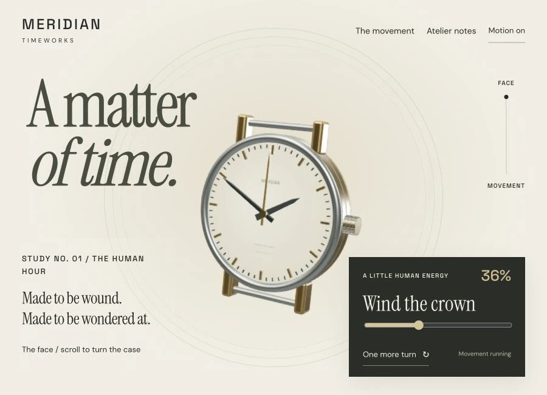
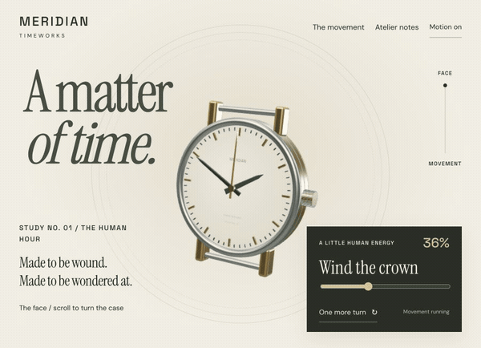

# MERIDIAN Timeworks

Watchmaking & luxury · Independent concept demo

A watchmaking study that turns a complete timepiece to reveal its mechanical reverse, then invites you to wind it.

**[Visit the live site ↗](https://northlight7.github.io/cinematic-meridian/)** · [Project notes & screenshots](https://github.com/northlight7/web-design-portfolio/tree/main/projects/meridian) · [Full portfolio](https://northlight7.github.io/web-design-portfolio/)



<details>
<summary>Play animated scroll preview (7 seconds)</summary>



</details>

## What to try

Scroll to the movement, wind the crown or use its slider, then switch between brass and steel.

## Design focus

The timepiece turns as one complete object. Its front-to-back reveal follows the mechanics of a watch.

Wind with the crown, slider or one-turn button. Switch the movement finish between brass and steel.

## Run locally

This is a buildless static site. Serve this repository with a static HTTP server, for example:

```sh
python3 -m http.server 8080
```

Then open http://localhost:8080 in your browser. Fonts, dependencies and visual assets are hosted locally with the site.

## About this work

Created through AI-assisted design and development, iterative art direction and browser testing. This is fictional concept work, with no client affiliation or commercial results claimed. The animation condenses an actual browser scroll walkthrough into a short silent loop.
